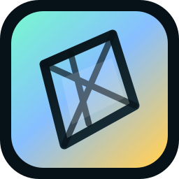

# 🌈 Prismwall Studio

> A portfolio-style website and functional wallpaper generator for creating crisp desktop and mobile wallpapers with clean patterns, tuned palettes, shareable seeds, and instant exports.

<p align="center">
  
</p>

## 🚀 Live Demo

🌐 **Live Website:** [https://custom-wallpaper-generator.vercel.app/](https://custom-wallpaper-generator.vercel.app/)

## ✨ What Is Prismwall Studio?

**Prismwall Studio** is a modern custom wallpaper generator built as both a web experience and a Tauri desktop app. It includes a polished portfolio-style landing page, a fully functional wallpaper generator, desktop/mobile export options, saved design states, and downloadable Windows builds.

The project is designed for users who want minimal, sharp, beautiful wallpapers without complicated design software.

## 🎨 Key Features

- 🖥️ **Desktop wallpaper export** at `3840 x 2160`
- 📱 **iPhone wallpaper export** at `1290 x 2796`
- 📐 **Custom export sizes** up to `7680 x 7680`
- 🎲 **Surprise design generator**
- 🔀 **Seed shuffle** for endless variations
- 🔢 **Manual seed input** for reproducible designs
- 🔗 **Copy design link** with pattern, palette, mode, seed, and clock state
- 🌓 **Dark and light wallpaper modes**
- ⏰ **Optional clock overlay** for exports
- ⭐ **Favorites** for saved designs
- 🕘 **Recent designs** with clickable thumbnails
- ↩️ **Undo / Redo** for generator changes
- ⌨️ **Keyboard shortcuts**
- 💾 **Download desktop, mobile, both, or custom size**
- 🪟 **Windows desktop app package**
- 🍎 **Mac download status page** instead of broken DMG links

## ⌨️ Keyboard Shortcuts

| Shortcut | Action |
|---|---|
| `R` | Shuffle current seed |
| `S` | Generate a surprise design |
| `Ctrl / Cmd + Z` | Undo |
| `Ctrl / Cmd + Y` | Redo |

## 🧭 Main Pages

| Page | Path |
|---|---|
| 🌐 Public portfolio landing page | `index.html` |
| 🧩 Packaged app landing page | `dist/index.html` |
| 🎨 Wallpaper generator | `dist/generator/index.html` |
| 🖼️ Wallpaper detail/export viewer | `dist/wallpaper/index.html` |
| 🍎 Mac download status page | `assets/downloads/mac.html` |
| 🪟 Windows download package | `assets/downloads/windows.zip` |

## 🛠️ Tech Stack

- **HTML5**
- **CSS3**
- **Vanilla JavaScript**
- **Canvas API**
- **Tauri 2**
- **Rust**
- **Vercel**

## 📁 Project Structure

```text
prismwall-studio/
  index.html
  README.md
  PROJECT_STRUCTURE.md
  package.json
  vercel.json
  .vercelignore

  assets/
    brand/
      app-icon.svg
      app-icon-1024.png
    images/
      dark.png
      light.png
    downloads/
      mac.html
      windows.zip

  dist/
    index.html
    styles.css
    generator/
      index.html
    wallpaper/
      index.html
    create/
      index.html
    images/
      app-icon.svg
      dark.png
      light.png
    downloads/
      mac.html
      windows.zip
    js/
      engine.js
      engine.global.js
      generator.js
      generator.global.js
      wallpapers.js
      home.js
      detail.js

  src-tauri/
    src/
      lib.rs
      main.rs
    icons/
    tauri.conf.json
    Cargo.toml
```

## 🧪 Run Locally

### 1. Clone the repository

```bash
git clone https://github.com/RensithUdara/Prismwall-Custom-Wallpaper-Generator.git
cd Prismwall-Custom-Wallpaper-Generator
```

### 2. Install dependencies

```bash
npm install
```

### 3. Preview the website

```bash
npm run preview
```

Then open:

```text
http://127.0.0.1:5178/
```

## 🖥️ Tauri Desktop App

### Run in development

```bash
npm run tauri:dev
```

### Build desktop app

```bash
npm run tauri:build
```

Windows build output is generated in:

```text
src-tauri/target/release/bundle/
```

## 📦 Downloads

### 🪟 Windows

The current Windows package is available at:

```text
assets/downloads/windows.zip
```

It contains:

- `Prismwall Studio_0.1.0_x64-setup.exe`
- `Prismwall Studio_0.1.0_x64_en-US.msi`
- `README.txt`

### 🍎 macOS

The old `.dmg` file was removed because it was outdated.

A fresh macOS `.dmg` must be generated on a macOS machine using:

```bash
npm run tauri:build
```

Until then, the project uses a custom Mac status page instead of a broken download link.

## 🌍 Deployment

This project is deployed on Vercel.

```bash
vercel deploy --prod
```

Production URL:

```text
https://custom-wallpaper-generator.vercel.app/
```

## 🧩 Generator URL State

The generator supports shareable URLs:

```text
/dist/generator/?pattern=3&palette=5&seed=777&mode=light&clock=1
```

Supported parameters:

| Parameter | Example | Description |
|---|---:|---|
| `pattern` | `3` | Pattern index |
| `palette` | `5` | Palette index |
| `seed` | `777` | Reproducible design seed |
| `mode` | `light` | `light` or `dark` |
| `clock` | `1` | Include clock overlay in exports |

## 🖼️ Wallpaper Patterns

Prismwall Studio includes multiple procedural pattern families:

- 🌄 Hills
- 🌊 Wave
- 🏜️ Dunes
- ⛰️ Peaks
- 🌀 Arcs
- ✍️ Sketchlines

## 🎨 Palettes

The generator includes several tuned color palettes, including:

- Charcoal
- Stone
- Blue
- Sunrise
- Fire
- Purple
- Toxic Glow
- Arctic Winter
- Neon Horizon
- Solar Flare
- Deep Forest
- Cosmic Blush Nebula
- Ocean Depths
- Blood Moon

## ✅ Current Status

- ✅ Portfolio landing page complete
- ✅ Functional wallpaper generator complete
- ✅ Windows app build generated
- ✅ App icon replaced
- ✅ Vercel deployment complete
- ✅ Mac broken download replaced with custom page/modal
- ⏳ Fresh macOS DMG pending macOS build environment

## 👤 Author

Built by **Rensith Udara**.

## 📄 License

This project is currently private/personal. Add a license file before distributing publicly.
